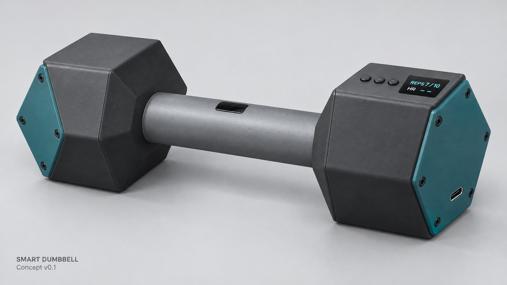

# Smart Dumbbell

ECE 198 student design project, Group 57, University of Waterloo.

A proposed lightweight smart dumbbell for CCCARE participants who can independently perform prescribed bicep curls at home. The device is intended to count complete repetitions, show progress, measure heart rate during movement, and send session records to a computer.

**Status: concept and planning stage.** Specifications, a concept CAD model, and pitch materials are available. Firmware, the trained model, the computer application, and physical performance tests have not been implemented or verified.



*AI-generated appearance study. This is not a photograph of a built prototype or a dimensionally exact CAD rendering.*

## Start here

- [Working specification](docs/specification.md) and [Chinese version](docs/specification-zh.md)
- [Specification PDF snapshot](docs/exports/Smart_Dumbbell_Preliminary_Specification_v01.pdf)
- [Decisions and open questions](docs/decisions.md)
- [Hardware and budget](docs/hardware.md)
- [Research assignments](docs/research-plan.md)
- [Pitch deck](presentation/Smart_Dumbbell_Pitch_Waterloo_v02.pptx), [speaker script](presentation/speaker_script.txt), and [editable script](presentation/Smart_Dumbbell_Speaker_Script_v02.docx)
- [CAD model](hardware/cad/Smart_Dumbbell_Concept_v01.dwg) and [model notes](hardware/cad/MODEL_NOTES.txt)

## Version 1 scope

- One exercise: bicep curl. Model classes: `curl`, `idle`, `other`.
- On-device inference and complete-cycle counting.
- OLED feedback and three session-control buttons.
- Heart-rate measurement during movement, with unreliable readings marked invalid.
- Local Wi-Fi communication and computer logging.
- Internal power and a custom hollow enclosure; no personal smartwatch required.
- Team purchase budget target: CAD 100 including taxes and shipping, subject to the borrowing assumptions in the specification.

The main feasibility risk is obtaining reliable optical heart-rate signals while gripping and moving the dumbbell. All acceptance numbers are proposed targets, not results.

## Proposed architecture

```text
Development: motion recordings -> labels -> computer training/testing -> deployed model

ADXL335 -> on-device model -> movement-cycle logic -> repetition count
MAX30102 -> signal processing / quality checks -> heart rate or invalid status
                                      |
                            OLED + local Wi-Fi
                                      |
                            computer view + CSV
```

Counting, sensing, and the display are intended to continue when the computer disconnects. The current specification uses the computer to set targets. Persistent offline history and later backfill are not yet part of the agreed baseline.

## Repository structure

| Directory | Contents |
|---|---|
| `docs/` | Specification, research plan, decisions, and exported snapshot |
| `hardware/` | Native CAD, model generator, rendering and assumptions |
| `presentation/` | Current pitch and matching narration |
| `firmware/` | Planned Nano ESP32 implementation; no code yet |
| `software/` | Planned computer interface and logging; no code yet |
| `ml/` | Planned data processing and classifier; no model yet |
| `tests/` | Acceptance-test tracking; no measured results yet |
| `data/` | Data-handling guidance; no participant recordings |

## Next milestones

- [x] Write preliminary requirements and acceptance targets.
- [x] Create a concept CAD model and appearance render.
- [x] Prepare a pitch deck and narration.
- [ ] Confirm loan modules, dimensions, connector clearances, and budget.
- [ ] Test grip heart-rate feasibility against a synchronized reference.
- [ ] Build a rule-based counting baseline and collect labelled motion recordings.
- [ ] Train and evaluate a compact classifier on held-out sessions.
- [ ] Integrate local control, display, Wi-Fi and recording.
- [ ] Revise and test the enclosure before fabrication.

## Collaboration

Use short branches such as `docs/hardware-check`, `firmware/sensor-readout`, and `ml/data-protocol`. Open a pull request for changes, explain what changed and what evidence supports it, and ask a teammate to review before merging. Keep requirements, hardware choices, CAD notes and presentation claims consistent.

Update the Markdown specification first. Treat dated PDF/PPTX exports as snapshots and regenerate them when needed. Do not record planned tests as passed.

## Attribution and project context

This is a student course project, not an official University of Waterloo or CCCARE product. The pitch uses the supplied University of Waterloo Faculty of Engineering presentation template. AI assisted with planning, drafting, CAD scripting, presentation preparation and the concept illustration. Team review and physical validation remain necessary.

The repository contains project-authored artifacts. Course handouts and the original university template remain in the course workspace. No open-source license has been selected; public visibility does not itself grant a license to reuse all material.
