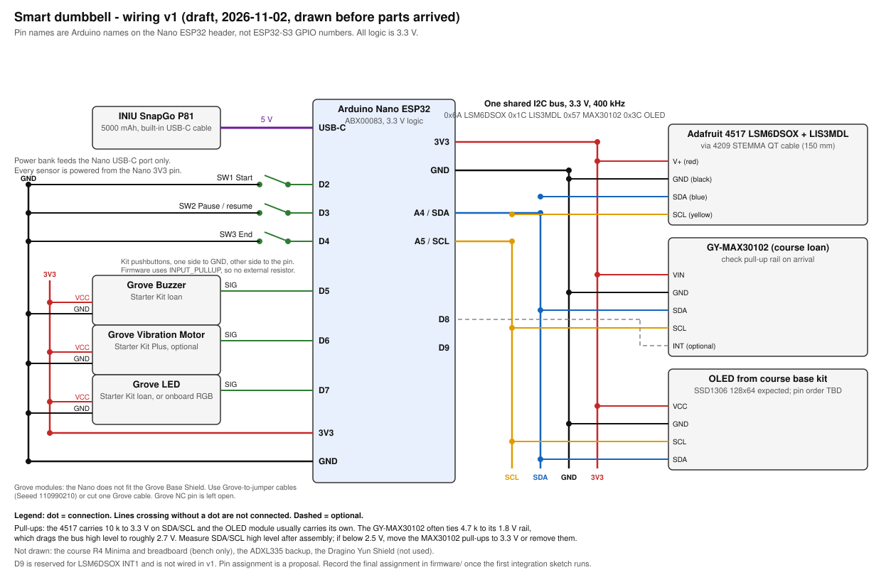

# Wiring v1 (draft)

Drawn 2026-11-02 from datasheets and module listings, before any part arrived. Treat every row as a proposal until the first integration sketch runs; then record the final pin assignment in `firmware/` and update this file.

Pin names are the Arduino names printed on the Nano ESP32 header (D2, A4, ...), not ESP32-S3 GPIO numbers. All logic is 3.3 V. The Nano is powered only through its USB-C port from the INIU SnapGo P81; every sensor and module is powered from the Nano 3V3 pin.

## Net list

| Net | Nano ESP32 pin | Goes to | Cable / wire | Notes |
|---|---|---|---|---|
| 5 V in | USB-C | INIU SnapGo P81 | Bank's built-in USB-C cable | No VIN, no bare LiPo in v1. |
| 3V3 | 3V3 | 4517 V+, MAX30102 VIN, OLED VCC, Grove VCC pins | Jumper wires | Nano on-board regulator supplies all 3.3 V loads. |
| GND | GND (both header pins) | All modules | Jumper wires | Star from the Nano GND pins; keep the I2C GND short. |
| SDA | A4 | 4517 SDA, MAX30102 SDA, OLED SDA | 4209 cable blue wire to the 4517; jumpers to the rest | One bus, 400 kHz. |
| SCL | A5 | 4517 SCL, MAX30102 SCL, OLED SCL | 4209 cable yellow wire to the 4517; jumpers to the rest | |
| SW1 Start | D2 | Kit pushbutton to GND | Jumper wires | `INPUT_PULLUP`; no external resistor. |
| SW2 Pause / resume | D3 | Kit pushbutton to GND | Jumper wires | `INPUT_PULLUP` |
| SW3 End | D4 | Kit pushbutton to GND | Jumper wires | `INPUT_PULLUP` |
| Buzzer | D5 | Grove Buzzer SIG | Grove-to-jumper cable | Active buzzer; drive HIGH to sound. |
| Vibration | D6 | Grove Vibration Motor SIG | Grove-to-jumper cable | Optional; only if the Plus kit is available. |
| LED | D7 | Grove LED SIG | Grove-to-jumper cable | Or use the on-board RGB LED (`LED_RED` etc., active low) and skip this net. |
| MAX30102 INT | D8 | GY-MAX30102 INT | Jumper wire | Optional; polling works without it. |
| IMU INT1 | D9 (reserved) | 4517 INT1 | Not wired in v1 | Only needed if firmware moves to data-ready interrupts. |

I2C addresses expected on the bus: LSM6DSOX 0x6A, LIS3MDL 0x1C (unused in v1), MAX30102 0x57, OLED 0x3C. No conflicts.

STEMMA QT / 4209 cable colours (Adafruit convention): black GND, red V+, blue SDA, yellow SCL. The 4517 board also has a 0.1" header with the same signals if a cable fails.

## Pull-ups

- The 4517 has 10 kΩ pull-ups to 3.3 V on SDA and SCL. The kit OLED module usually has its own (4.7 kΩ or 10 kΩ).
- Many GY-MAX30102 boards tie 4.7 kΩ pull-ups to their on-board 1.8 V rail. In parallel with the 3.3 V pull-ups this drags the bus high level to roughly 2.7 V, which is close to the ESP32-S3 input-high threshold (about 2.5 V). After assembly, measure the SDA and SCL high level with a multimeter. If it is below 2.5 V or the MAX30102 reads unreliably, move its two pull-up resistors to 3.3 V or remove them.

## Things that can only be settled when the parts arrive

1. Kit OLED pin order (GND-VCC-SCL-SDA or VCC-GND-SCL-SDA differ between modules) and its I2C address (0x3C or 0x3D).
2. GY-MAX30102 pull-up rail (see above) and whether its INT pin is broken out.
3. Which Grove modules are actually in the borrowed kit (the photographed tray holds a buzzer and an LED socket; no vibration motor was visible).
4. Grove-to-jumper cables. The Nano does not fit the Grove Base Shield, so either borrow Grove 4-pin to female-jumper cables (Seeed 110990210) or cut one Grove cable.
5. Real cable lengths versus the enclosure layout. The 4209 cable is 150 mm.

Not drawn: UNO R4 Minima and breadboard (bench only), the ADXL335 backup, the Dragino Yún Shield (available on loan, not used).
