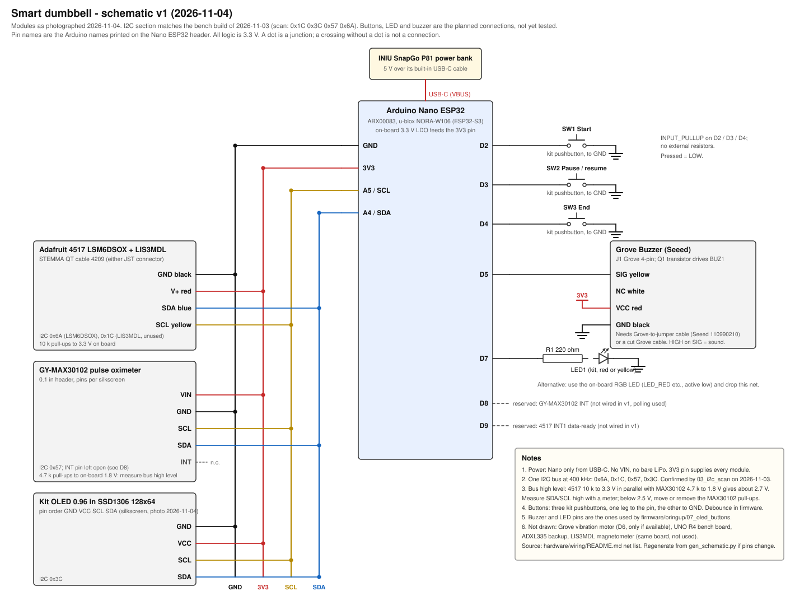

# Wiring v1

Net list drawn 2026-11-02 from datasheets, before any part arrived. Schematic redrawn 2026-11-04 from the modules in hand (photos of the Nano ESP32, Adafruit 4517, GY-MAX30102, kit OLED and Grove buzzer).

Status 2026-11-04: the I2C part (Nano + 4517 + GY-MAX30102 + OLED on one bus) is the bench build that passed `03_i2c_scan`, `04_imu_stream`, `05_max30102` and `07_oled_buttons` (display only) on 2026-11-03. Buttons, LED and buzzer are still the planned connections from `07_oled_buttons`, not yet wired or tested. Record the final pin assignment in `firmware/` when the integration sketch runs and update this file.

## Schematic



Generated by `gen_schematic.py` in this folder; edit the script, not the SVG, when a pin changes:

```bash
python3 hardware/wiring/gen_schematic.py hardware/wiring/schematic-v1.svg
```

## Breadboard view (2026-11-02, pre-hardware)


Pin names are the Arduino names printed on the Nano ESP32 header (D2, A4, ...), not ESP32-S3 GPIO numbers. All logic is 3.3 V. The Nano is powered only through its USB-C port from the INIU SnapGo P81; every sensor and module is powered from the Nano 3V3 pin.

## Net list

| Net | Nano ESP32 pin | Goes to | Cable / wire | Notes |
|---|---|---|---|---|
| 5 V in | USB-C | INIU SnapGo P81 | Bank's built-in USB-C cable | No VIN, no bare LiPo in v1. |
| 3V3 | 3V3 | 4517 V+, MAX30102 VIN, OLED VCC, Grove VCC pins | Jumper wires | Nano on-board regulator supplies all 3.3 V loads. |
| GND | GND (both header pins) | All modules | Jumper wires | Star from the Nano GND pins; keep the I2C GND short. |
| SDA | A4 | 4517 SDA, MAX30102 SDA, OLED SDA | 4209 cable blue wire to the 4517; jumpers to the rest | One bus, 400 kHz. |
| SCL | A5 | 4517 SCL, MAX30102 SCL, OLED SCL | 4209 cable yellow wire to the 4517; jumpers to the rest | |
| SW1 Start | D2 | Kit pushbutton to GND | Jumper wires | `INPUT_PULLUP`; no external resistor. |
| SW2 Pause / resume | D3 | Kit pushbutton to GND | Jumper wires | `INPUT_PULLUP` |
| SW3 End | D4 | Kit pushbutton to GND | Jumper wires | `INPUT_PULLUP` |
| Buzzer | D5 | Grove Buzzer SIG | Grove-to-jumper cable | Active buzzer; drive HIGH to sound. |
| Vibration | D6 | Grove Vibration Motor SIG | Grove-to-jumper cable | Not in the borrowed kit; not drawn in the schematic. Keep D6 free. |
| LED | D7 | Grove LED SIG | Grove-to-jumper cable | Or use the on-board RGB LED (`LED_RED` etc., active low) and skip this net. |
| MAX30102 INT | D8 (reserved) | GY-MAX30102 INT | Not wired in v1 | INT is broken out on the module; polling works without it. |
| IMU INT1 | D9 (reserved) | 4517 INT1 | Not wired in v1 | Only needed if firmware moves to data-ready interrupts. |

I2C addresses expected on the bus: LSM6DSOX 0x6A, LIS3MDL 0x1C (unused in v1), MAX30102 0x57, OLED 0x3C. No conflicts.

STEMMA QT / 4209 cable colours (Adafruit convention): black GND, red V+, blue SDA, yellow SCL. The 4517 board also has a 0.1" header with the same signals if a cable fails.

## Pull-ups

- The 4517 has 10 kΩ pull-ups to 3.3 V on SDA and SCL. The kit OLED module usually has its own (4.7 kΩ or 10 kΩ).
- Many GY-MAX30102 boards tie 4.7 kΩ pull-ups to their on-board 1.8 V rail. In parallel with the 3.3 V pull-ups this drags the bus high level to roughly 2.7 V, which is close to the ESP32-S3 input-high threshold (about 2.5 V). After assembly, measure the SDA and SCL high level with a multimeter. If it is below 2.5 V or the MAX30102 reads unreliably, move its two pull-up resistors to 3.3 V or remove them.

## Settled from the parts in hand (2026-11-04)

1. Kit OLED pin order is **GND-VCC-SCL-SDA** (silkscreen), address 0x3C (scan 2026-11-03).
2. GY-MAX30102 header is VIN-GND-SCL-SDA-INT; INT is broken out but left open in v1. Its pull-up rail is still unmeasured: do the SDA/SCL high-level check above before trusting long runs.
3. The buzzer is the Seeed Grove Buzzer (J1 Grove socket, transistor Q1 driving BUZ1). No vibration motor seen, so the D6 net is dropped from the schematic.
4. The 4517 has two STEMMA QT sockets plus the 0.1" header (VIN, 3Vo, GND, SCL, SDA, INT2 on the labelled edge); either socket works for the 4209 cable.

## Still open

1. Grove-to-jumper cable for the buzzer. The Nano does not fit the Grove Base Shield, so either borrow a Grove 4-pin to female-jumper cable (Seeed 110990210) or cut one Grove cable.
2. Real cable lengths versus the enclosure layout. The 4209 cable is 150 mm.
3. SDA/SCL high level with the MAX30102 on the bus (multimeter).
4. Buttons, LED and buzzer: wire and finish `07_oled_buttons` step 7.

Not drawn: UNO R4 Minima and breadboard (bench only), the ADXL335 backup, the Dragino Yún Shield (available on loan, not used).
